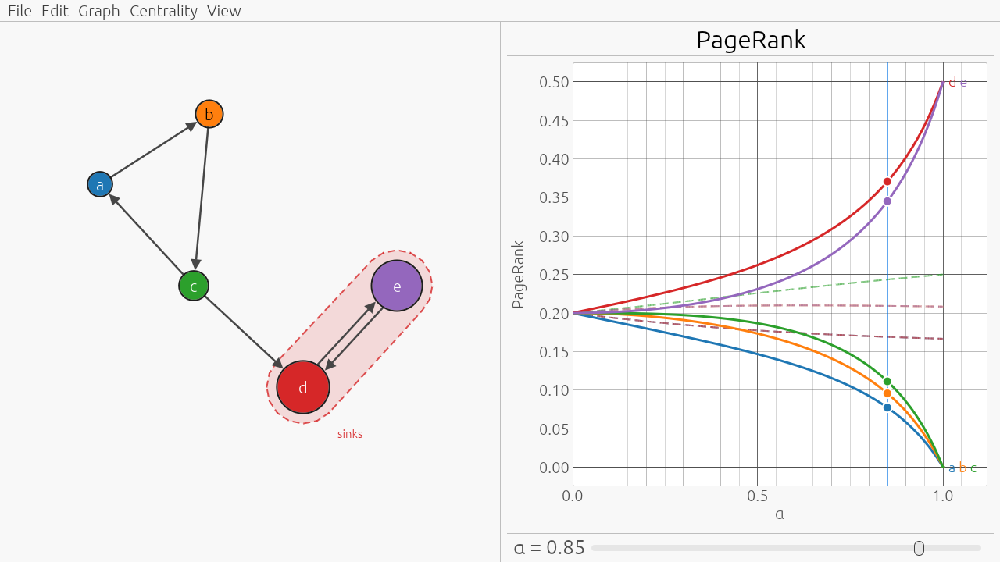
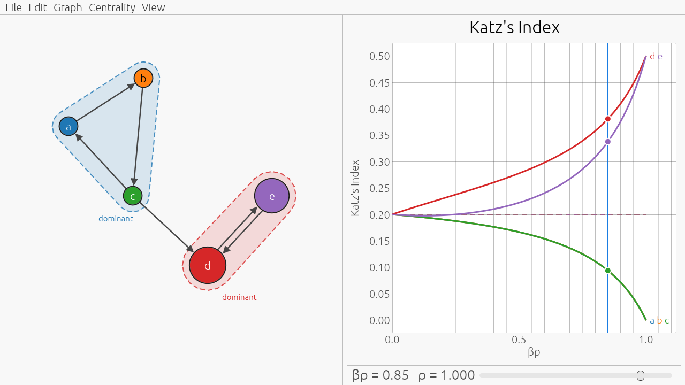
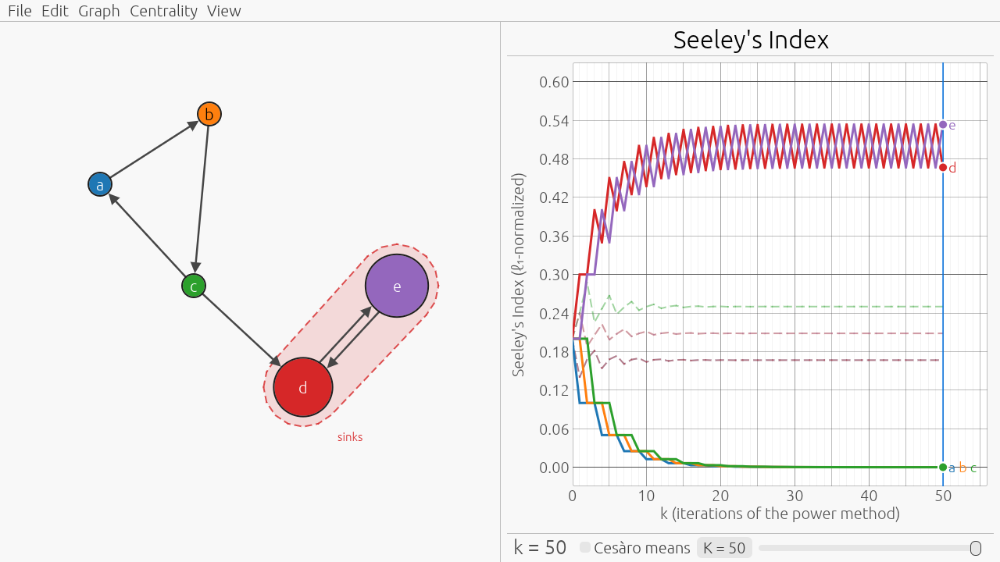
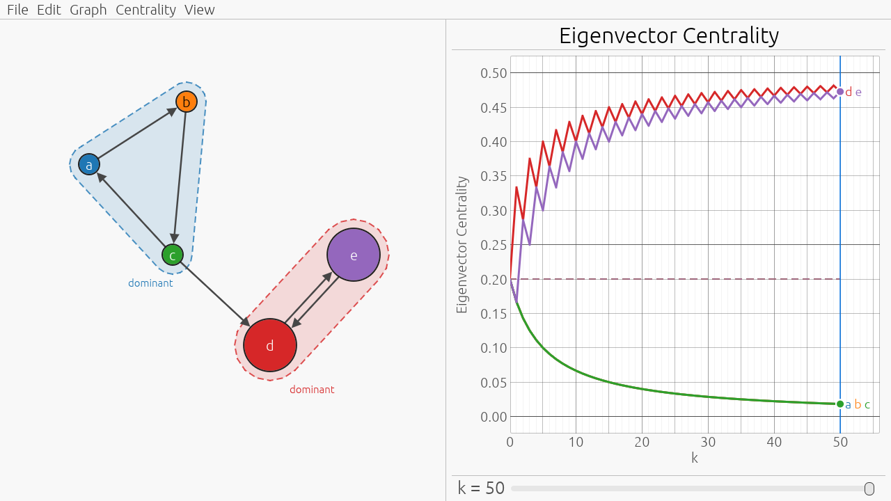
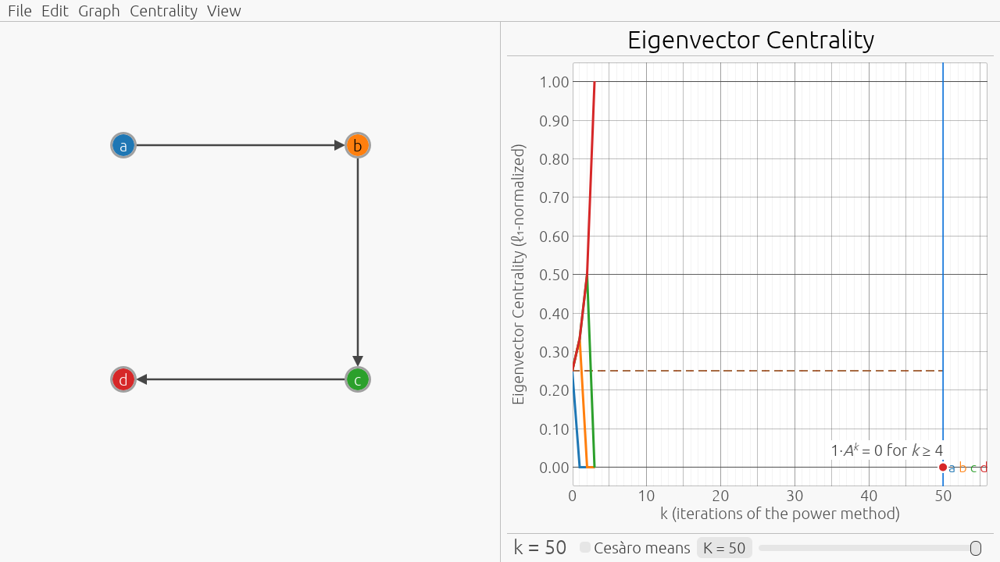
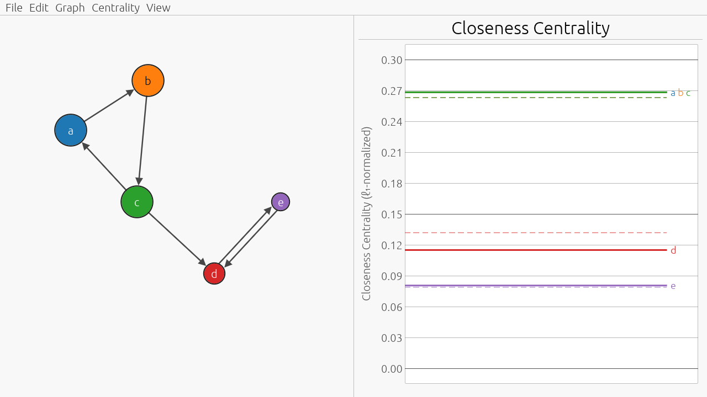
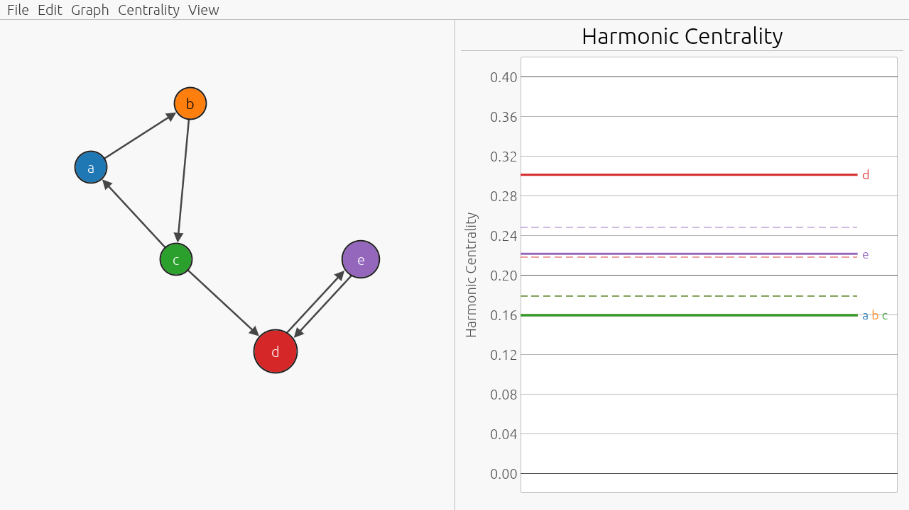
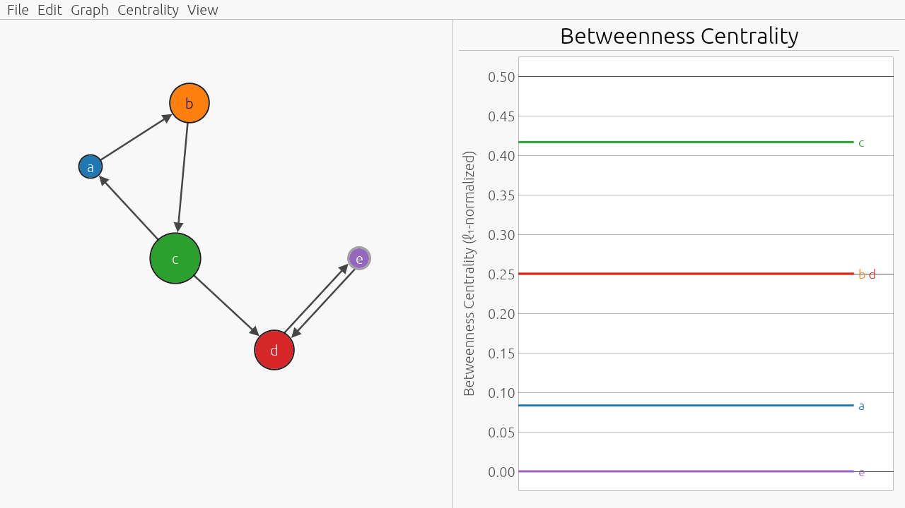

# Centrality Explorer

A teaching aid to build intuition about centrality measures. The instructor
edits a small graph at a projector, and the class watches, in real time, how
the score of each node changes. There are seven centralities, in three
families:

| Family | Centralities | x-axis of the plot |
|---|---|---|
| Damped spectral | PageRank, Katz's index | α ∈ [0 . . 1] for PageRank, βρ ∈ [0 . . 1] for Katz's index |
| Power method | Seeley's index, eigenvector centrality | The iteration *k* = 0, 1, …, 50 |
| Geometric | Closeness, harmonic centrality, betweenness | None: the curves are horizontal lines |

The central picture is the plot of the score of each node against the
parameter of the centrality. When an edit closes or opens a sink, the
PageRank curves change shape all of a sudden, most visibly near α = 1, where
the score concentrates on the sinks.

The first two families are related: at the right end of their plots, the
damped indices tend to the limits of the power methods, when these converge.
PageRank tends, as α → 1, to the limit of the iterates of Seeley's index, and
Katz's index tends, as βρ → 1, to the limit of the iterates of eigenvector
centrality. Plotting the iterates shows what happens when they do not
converge: on periodic structures the curves can zigzag forever, which the
damped limits hide.

## Building and Running

```sh
cargo run --release
```

The crate is compiled with `-C target-cpu=native` (see `.cargo/config.toml`),
so build it on the machine that runs it: a binary built on a recent CPU may
not run on an older one.

## Reading the Screen

- The graph is on the left. On the right, the name of the current centrality
  is over the plot of its curves, and the slider of its parameter, if any, is
  underneath.
- Each node has its own color, shared by its curve; a node keeps its color
  for as long as it exists, whatever the centrality.
- The size of a node shows its score at the current value of the parameter:
  its area is proportional to the score, within a minimum and a maximum
  size, and a node with score 1/*n*, where *n* is the number of nodes, has
  the standard size.
- A node whose score is exactly zero has a thicker gray outline: for
  example, the nodes outside the sinks in the limit of PageRank at α = 1, or
  every node once the iterates of eigenvector centrality vanish. A score
  that is merely small, such as that of the same nodes at α = 0.99, is not
  zero, and keeps the dark outline.
- The vertical line in the plot marks the current value of the parameter,
  with a dot on each curve; clicking or dragging in the plot moves it. Node
  labels at the right end of the plot name the curves.
- After each edit that adds or removes nodes or edges, the curves from
  before the edit remain visible as faded dashed lines, until the next such
  edit (there are none after opening a file or creating a new or random
  graph). They show the current centrality on the graph from before the
  edit, so they survive a switch of centrality: make an edit, then switch
  among the centralities to compare the effect of the same edit on each.
- The y-axis adapts to the largest score; View → Fixed y-axis [0, 1] keeps
  it at [0 . . 1].

Hovering a node highlights it and its curve, and shows the node's score;
hovering a curve highlights it and its node.

### PageRank and Katz's Index

- The x-axis is the damping factor α for PageRank, and βρ for Katz's index,
  where β is the parameter of the index and ρ is the spectral radius of the
  adjacency matrix, shown next to the slider. If ρ = 0, the x-axis is β
  itself (see below). Both sliders start at 0.85, and each centrality keeps
  its own value.
- The right end of the curves is the exact limit as α → 1, or as βρ → 1 if
  ρ > 0.
- For PageRank, shaded hulls labeled “sinks” mark the sinks: terminal
  strongly connected components (groups of nodes with no edge leaving them)
  other than lone dangling nodes. A dangling node is terminal, but the walk
  leaves it by jumping to every node, so it does not keep the rank that
  enters it.
- For PageRank, nodes with a dashed outline are dangling: they have no
  outgoing edges, so the walk jumps from them to a node chosen uniformly at
  random.
- For Katz's index, if ρ > 0, shaded hulls labeled “dominant” mark the
  dominant classes: strongly connected components whose spectral radius is
  ρ, which determine the limit as βρ → 1. There are no dashed outlines,
  since dangling nodes are not special for the adjacency matrix.

### Seeley's Index and Eigenvector Centrality

- The x-axis is the iteration *k* = 0, 1, …, 50 of the power method, and the
  curves join the iterates with straight segments, so an oscillation shows
  up as a zigzag. The slider takes integer values, starts at 50, and is
  shared by the two centralities; node sizes show the iterate at its *k*.
- Seeley's index shows the same hulls and dashed outlines as PageRank, and
  eigenvector centrality the same hulls as Katz's index.
- If the iterates of eigenvector centrality vanish within the plotted
  iterations, as they do on every graph without cycles (self-loops
  included) whose longest path has fewer than 50 arcs, the curves stop at
  the last nonzero iterate, a note on the plot (“1·*A*ᵏ = 0 for *k* ≥ …”)
  says from which iteration on, and from that iteration on all nodes have
  the minimum size.

### Closeness, Harmonic Centrality, and Betweenness

- The scores have no parameter: each curve is a horizontal line at the
  score of its node, and there is no slider, no vertical line, and no tick
  on the x-axis. End labels, hovering, and the curves from before the last
  edit work as for the other centralities.
- There are no hulls and no dashed outlines.

## Examples

The screenshots below show the same graph under each centrality, in the
order of the Centrality menu: a triangle a → b → c → a, with arcs c → d and
d → e, right after the edit that adds e → d and closes d and e into a
2-cycle. The faded dashed curves show the graph before that edit, when e was
dangling. The parameters are at their defaults: α = βρ = 0.85, and *k* = 50.

### PageRank



After the edit, d and e form a sink, shaded in the graph. As α → 1, their
PageRank rises to ½ each, and that of a, b, and c falls to zero, all of a
sudden near α = 1: drag the slider to α = 1, and a, b, and c get a gray
outline. Before the edit, the walk restarted from the dangling node e, there
was no sink, and the limit at α = 1 (the right end of the dashed curves) is
positive on every node.

### Katz's Index



The triangle and the 2-cycle both have spectral radius 1 = ρ, so both are
dominant (two hulls), and the first leads to the second (ν = 2): as βρ → 1,
the limit is ½ on d and e, and zero on the upstream triangle, although the
triangle is dominant, too. The curves of a, b, and c coincide, since each of
them is reached only from the previous node of the triangle. Before the
edit, every node had exactly one incoming arc, so **1** *A* = **1**, and
Katz's index is uniform for every β: the dashed curves coincide at 0.2.

### Seeley's Index



The walk starts from the uniform distribution. The probability leaving the
triangle through c → d never comes back, so the iterates of a, b, and c
decay, in steps, as the probability goes around the triangle; at *k* = 50
they are tiny, but not zero, and the outlines stay dark. The 2-cycle is
periodic, and d and e alternate forever, with constant amplitude: PageRank
at α = 1 gives ½ to both, the long-run average, and hides the oscillation.
Before the edit, the jump from the dangling node e broke the periodicity,
and the dashed iterates converge, to the limit of PageRank at α = 1 of that
graph.

### Eigenvector Centrality



The iterate **1** *A*ᵏ counts the walks of length *k* ending at each node.
Each node of the triangle is reached by exactly one such walk, whereas the
walks reaching d and e grow linearly with *k*, d being fed by both c and e.
The iterates converge to the limit of Katz's index, ½ on d and e and zero on
the triangle, but slowly, like 1/*k*, because ν = 2: at *k* = 50, the
triangle still has 1/55 each, and the zigzag of d and e fades like
1/*k*, too. Before the edit, **1** *A*ᵏ = **1** for every *k*, so the
dashed iterates are uniform.



Here the iterates vanish. The 4-cycle a → b → c → d → a (dashed: on a
cycle, **1** *A*ᵏ = **1**) loses the arc d → a, leaving the path
a → b → c → d. Now **1** *A* = (0, 1, 1, 1), since no walk of length 1 ends
at a; then **1** *A*² = (0, 0, 1, 1), **1** *A*³ = (0, 0, 0, 1), and
**1** *A*⁴ = 0. The curves stop at *k* = 3, the note says that the iterates
vanish from *k* = 4 on, and at *k* = 50 every node has score zero: all
outlines are gray, and all labels sit at 0.

### Closeness



The nodes of the triangle have the largest closeness, and the edit lowers
the closeness of d: once e reaches d, the distance *d*(e, d) = 1 joins the
sum of the distances to d, which goes from 6 to 7. Closeness takes into
account only the nodes that reach a node, so being reached by more nodes
can lower it.

### Harmonic Centrality



The same edit raises the harmonic centrality of d, from
1/3 + 1/2 + 1 = 11/6 to 11/6 + 1 = 17/6, which now ranks d above e; a, b,
and c, which are reached only from the triangle, come last. The harmonic
centrality of e does not change (25/12), but its share does: normalization
spreads the gain of d over all nodes.

### Betweenness



Node c is on the shortest paths from a and b to d and e, and from b to a,
so it has the largest betweenness. Node e is on no shortest path between two
other nodes, so its betweenness is zero, and its outline is gray. The edit
adds no shortest path through any node, so the dashed curves coincide with
the current ones.

The screenshots are regenerated, on a machine with a GPU, by

```sh
cargo test --release --test test_ui -- --ignored test_render_centralities test_render_eigenvector_vanishing
```

## Editing

| Action | Gesture |
|---|---|
| Add a node | Double-click on empty canvas |
| Add or remove an edge | Click the source node, then the target node |
| Remove an edge | Click it |
| Cancel a pending edge | Esc, or click on empty canvas |
| Move a node | Drag it |
| Move the whole graph | Drag empty canvas |
| Rename a node | Type over it; Enter confirms, Esc cancels |
| Delete a node | Backspace or Delete over it |
| Self-loops, and everything else | Right-click menu |

## Shortcuts

Cmd is Ctrl on Linux and Windows, and Alt is Option on macOS.

| Command | Shortcut |
|---|---|
| New graph (directed or undirected) | Cmd-N |
| Open, Save, Save As | Cmd-O, Cmd-S, Cmd-Shift-S |
| Undo, Redo | Cmd-Z, Cmd-Shift-Z |
| Random graph | Cmd-R |
| Force-directed, circle, components layout | Cmd-1, Cmd-2, Cmd-3 |
| PageRank, Katz's index | Cmd-Alt-1, Cmd-Alt-2 |
| Seeley's index, eigenvector centrality | Cmd-Alt-3, Cmd-Alt-4 |
| Closeness, harmonic centrality, betweenness | Cmd-Alt-5, Cmd-Alt-6, Cmd-Alt-7 |
| Zoom in, out, reset | Cmd-+, Cmd-−, Cmd-0 |
| Full screen | Cmd-Shift-F |
| Change α, βρ, or β by 0.01 (0.05) | ← and → (with Shift) |
| Change *k* by 1 (5) | ← and → (with Shift) |

The centralities are also in the Centrality menu, grouped by family.

Undo and redo cover every change to the graph, so flipping between them is a
quick way to show the same graph before and after an edit. Switching
centrality and changing a parameter are not changes to the graph: they are
not undoable, and they do not count as unsaved changes.

Random graphs follow the directed Chung–Lu model, whose in-degrees and
out-degrees follow a power law. Sparse random graphs often have no sink, in
which case PageRank at α = 1 vanishes on no node (see below); add the
missing structure by hand.

## Files

Graphs are saved as JSON, together with the current centrality, α, and the
parameter of Katz's index; opening a file restores them. Files saved by
version 0.1.0 open with PageRank, and with the parameter of Katz's index at
0.85. The iteration *k* is not saved, and starts at 50.

## The Mathematics

The graph has *n* nodes and adjacency matrix *A*: *a*ᵢⱼ = 1 if there is an
arc from *i* to *j*, and 0 otherwise; a self-loop sets *a*ᵢᵢ = 1, and an
undirected edge is a pair of opposite arcs. ρ is the spectral radius of *A*,
and **1** is the vector of ones. *P* is the transition matrix of the random
walk on the graph: a node with *d* > 0 successors moves to each of them with
probability 1/*d*, and a dangling node moves to every node with probability
1/*n*.

Every centrality except betweenness is oriented by incoming paths: a node
is central if it is reached. Thus, spectral scores are row vectors multiplied
on the right by *A* or *P*, and closeness and harmonic centrality use the
distances *d*(*y*, *x*) from the other nodes *y* to *x*. Betweenness counts
the shortest paths passing through a node, and does not change if all arcs
are reversed.

Every score vector shown, in the plot and in node sizes, is normalized to
sum to 1, so it shows the share of each node in the total score. The only
exception is a vector that is identically zero, which is shown as zero: all
curves at 0, and all nodes at the minimum size.

### PageRank

Dangling nodes jump uniformly to every node, and the preference vector is
uniform. For α < 1 the curves are computed exactly, by solving
(*I* − α *P*ᵀ) *x* = (1 − α) *v* at each plotted α, rather than through a
truncated power series, which is inaccurate near α = 1 on periodic
structures.

The value at α = 1 is the exact limit of PageRank as α → 1. If the graph has
sinks, the limit is supported exactly on them: each sink receives the
probability that a walk from the uniform distribution is absorbed into it,
spread according to its stationary distribution, and every other node,
including dangling ones, gets zero. If instead the graph has no sink, every
terminal component is a dangling node, the walk restarts from them, and the
limit is the stationary distribution of the walk, which is positive on every
node.

### Katz's Index

Katz's index with parameter β counts the walks ending at each node (paths
that may repeat nodes and arcs), weighting a walk of length *t* by βᵗ:

*k*(β) = **1** Σ<sub>*t* ≥ 0</sub> βᵗ *A*ᵗ = **1** (*I* − β *A*)⁻¹, for
0 ≤ β < 1/ρ.

It is shown normalized, as κ(β) = *k*(β) / ‖*k*(β)‖₁. The term *t* = 0 (the
walk of length zero from each node to itself) is included, so κ(0) is
uniform, like PageRank at α = 0. The curves are computed exactly, by solving
(*I* − β *A*ᵀ) *k*ᵀ = **1**ᵀ at each plotted β, except at the right end when
ρ > 0 (see below).

If ρ > 0, the x-axis is βρ ∈ [0 . . 1], that is, β as a fraction of its
range [0 . . 1/ρ), so that the axis does not change when an edit changes ρ,
and the curves from before the edit line up. When the graph has cycles but
no two of them share a node, for example when there is a single cycle, ρ = 1,
and βρ = β.

If ρ = 0, that is, if the graph has no cycles (self-loops included), *A* is
nilpotent, the sum is finite, and every β is allowed. There is no natural
range, so the x-axis is β ∈ [0 . . 1]. At β = 1, the score of a node is
proportional to the number of walks ending at it, including the walk of
length zero.

If ρ > 0, the value at βρ = 1 is the exact limit of κ(β) as βρ → 1, not κ at
some β close to 1/ρ; the limit always exists, even though *k*(β) diverges.
Call *dominant* (or *basic*) the strongly connected components *C* whose
spectral radius ρ<sub>*C*</sub>, that of the restriction of *A* to *C*,
equals ρ (within a relative tolerance of 10⁻⁹), and let ν be the maximum
number of dominant classes on a path of the condensation, the acyclic graph
of the strongly connected components. Then (1 − βρ)<sup>ν</sup> *k*(β) tends
to a nonzero nonnegative vector, and κ(β) tends to its normalization.

The limit is supported exactly on the dominant classes that end a chain of ν
dominant classes, and on the nodes they reach. In particular, when dominant
classes are chained (ν > 1), the upstream ones get zero: on a ⇄ b → c ⇄ d,
both cycles have spectral radius 1 = ρ, ν = 2, and the limit is ½ on c and d
and zero on a and b. The nodes reached by the dominant classes that end a
chain of ν dominant classes get a positive limit, too: on the 2-cycles
a ⇄ b and c ⇄ d with arcs b → e and d → e, the limit is ⅙ on each of a, b,
c, and d, and ⅓ on e.

### Seeley's Index

Seeley's index is a stationary distribution of the random walk, that is, a
solution of *x* = *x P* that is a distribution; it may not be unique. The
plot shows the iterates *x*₀, *x*₁, …, *x*₅₀ of the power method from the
uniform distribution:

*x*₀ = (1/*n*, …, 1/*n*), *x*ₖ₊₁ = *x*ₖ *P*.

The iterate *x*ₖ is the distribution of the walk after *k* steps from a node
chosen uniformly at random, so it sums to 1. When the iterates converge,
their limit is the limit of PageRank at α = 1. On periodic structures they
can oscillate forever: on a ⇄ b, c → a they alternate, from *k* = 1 on,
between (⅔, ⅓, 0) and (⅓, ⅔, 0). PageRank at α = 1 is in any case the
long-run average of the iterates (here, (½, ½, 0)), so the damped limit hides
the oscillation.

### Eigenvector Centrality

Eigenvector centrality is a dominant left eigenvector of *A*, that is, a
nonnegative nonzero solution of *x A* = ρ *x*. The plot shows the iterates *x*₀,
*x*₁, …, *x*₅₀ of the power method from the vector of ones, normalized:

*x*₀ = (1/*n*, …, 1/*n*), *x*ₖ₊₁ = *x*ₖ *A* / ‖*x*ₖ *A*‖₁.

The iterate *x*ₖ is **1** *A*ᵏ normalized: the number of walks of length *k*
ending at each node, as a fraction of all walks of length *k*. When the
iterates converge, their limit is the limit of Katz's index at βρ = 1. But
the iterates may also vanish, oscillate, or converge slowly:

- If the graph has no cycles (self-loops included), that is, if ρ = 0, the
  iterates vanish: if the longest path has length *L* (necessarily less
  than *n*), then **1** *A*ᵏ = 0 for *k* > *L*. All entries are nonnegative,
  so there is no cancellation, and vanishing is detected exactly. If
  *L* < 50, the curves stop at *x*<sub>*L*</sub>, and the note on the plot
  reads “1·*A*ᵏ = 0 for *k* ≥ *L* + 1”, with the value of *L* + 1;
  otherwise, the curves run to *k* = 50, with no note.
- On periodic structures the iterates can oscillate forever: on an
  undirected star they alternate between the uniform vector and the vector
  with ½ on the center and the other half split evenly among the leaves.
- When ν > 1, convergence is slow, like 1/*k*, and at *k* = 50 the curves are
  still visibly drifting: on a → b with a self-loop on both nodes,
  **1** *A*ᵏ = (1, *k* + 1), so at *k* = 50 node a still has score 1/52,
  although its limit is zero.

### Closeness, Harmonic Centrality, and Betweenness

These follow Paolo Boldi and Sebastiano Vigna, *Axioms for Centrality*,
Internet Mathematics, 2014. For closeness and harmonic centrality, the
distance *d*(*y*, *x*) (the length of a shortest path from *y* to *x*, or ∞
if there is none) is measured towards *x*, so that, as for the spectral
centralities, a node is central if it is reached.

- The closeness of *x* is 1 / Σ *d*(*y*, *x*), where the sum is over the
  nodes *y* such that 0 < *d*(*y*, *x*) < ∞, and 0 if no other node reaches
  *x*.
- The harmonic centrality of *x* is Σ<sub>*y* ≠ *x*</sub> 1 / *d*(*y*, *x*),
  with 1/∞ = 0.
- The betweenness of *x* is Σ σ<sub>*yz*</sub>(*x*) / σ<sub>*yz*</sub> over
  the ordered pairs of distinct nodes *y*, *z* different from *x* such that
  σ<sub>*yz*</sub> > 0, where σ<sub>*yz*</sub> is the number of shortest
  paths from *y* to *z* and σ<sub>*yz*</sub>(*x*) is the number of those
  passing through *x*. In undirected graphs every path is counted twice,
  once in each direction, which normalization removes.

Self-loops affect none of the three. The scores are computed exactly, by a
breadth-first visit from every node (for betweenness, with Brandes's
algorithm).

Closeness takes into account only the nodes that reach *x*, so on graphs
that are not strongly connected it can reward a node for being reached by
few: on a → b → c, before normalization, closeness ranks b above c (1
against ⅓), because only a reaches b, whereas harmonic centrality ranks c
above b (3/2 against 1).
